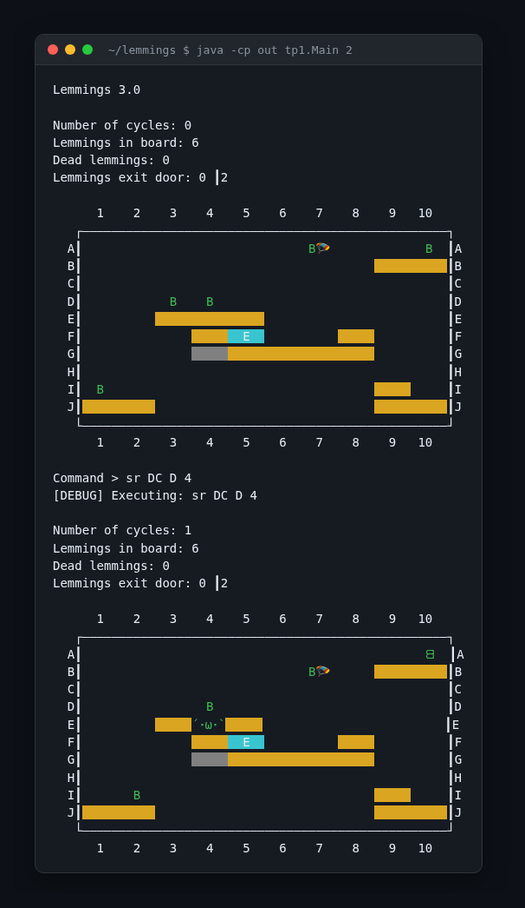
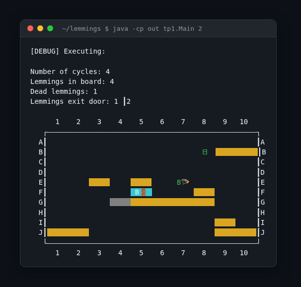

# Lemmings

A console version of the classic Lemmings game in Java: lemmings walk on their own across a 10x10 board and you keep them alive by giving them roles until enough of them reach the exit door.



## What it is

Second-year Programming Technology (TP1) assignment at UCM, built in late 2024. The course hands you the skeleton of the game and asks you to grow it over three deliveries: the walking simulation, then a command interpreter, then roles, level files and the exception hierarchy. This repo is the final delivery.

Every turn you type a command (or nothing) and the board advances one cycle: lemmings step, fall, turn around at walls and die if they fall too far or off the board.

## How it works

- The board is 10 columns by 10 rows; rows are letters A to J, columns 1 to 10. Cells hold walls (yellow), metal walls (grey), the exit door (`E`) and lemmings (`B`, mirrored when walking left).
- A lemming walks in its current direction and turns around at walls and edges. With nothing under it, it falls; landing after a fall of 3 or more cells kills it, and so does falling off the board.
- Roles change what a lemming does: `Walker` is the default, `Parachuter` falls without taking damage, `DownCaver` digs through the wall directly below it. Metal walls cannot be dug.
- Three levels (0, 1, 2) are defined in code; `load <file>` reads one from text (first line `cycle inBoard dead exited toWin`, then one object per line such as `(2,3) Lemming RIGHT 0 Walker`).
- You win when no lemmings are left on the board and at least `lemmingsToWin` went through the door.
- Commands: empty line or `n` advances a cycle, `sr ROLE ROW COL` sets a role (`W`, `P`, `DC`), `r [level]` resets, `l <file>` loads, `h` help, `e` exit.



## Stack

Java 17 or newer, no build tool, no dependencies apart from JUnit 5 for the course test harness (`src/tp1/Tests_V3.java`, which needs expected-output files that are not in this repo).

## Run it

```
mkdir -p out
javac -d out $(find src -name '*.java' ! -name 'Tests_V3.java')
java -cp out tp1.Main 2
```

The optional argument is the starting level (0, 1 or 2; default 2). A second argument of any value switches to the plain view without ANSI colours.

## Project layout

```
src/tp1/        Main, Controller, game logic, game objects and console views
src/commands/   one class per command plus the CommandGenerator parser
src/logic/      lemming roles (Walker, Parachuter, DownCaver)
src/exceptions/ parse, execute, load and off-board exceptions
```
